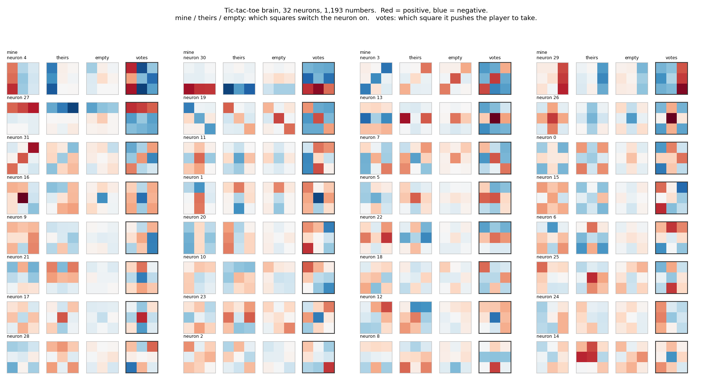

# Rewire

Can an AI read another network's brain and rewire it for new rules?

On 2026-11-02 an MIT group showed frontier models reading and writing raw neural network weights
([blog](https://rikiyat.github.io/blog/weight-space-programming/)), and Alex Krentsel showed the skill only shows up
in the newest models ([thread](https://x.com/AlexKrentsel/status/2117376683724660898)). Those tests ask a model to
write a network from scratch or remove a bad habit. Rewire asks a harder question: here is a trained brain that plays
3x3 tic-tac-toe perfectly. Read its weights and change them so it plays 4x4.

## The patient

A tiny network: 27 inputs (mine, theirs, empty for each square), 32 hidden neurons, 9 outputs (one score per square).
1,193 numbers in total, trained in about a minute on a laptop CPU to copy perfect play.

| Brain | Params | Best move picked | vs perfect player | vs random player |
|---|---|---|---|---|
| 3x3, 16 neurons | 601 | 97.7% | 87% draw, 13% loss | 91% win |
| **3x3, 32 neurons** | **1,193** | **99.6%** | **100% draw** | **92% win, 0 losses** |



Each card is one neuron. Several are readable by eye. Neuron 30 fires when you own the bottom row and votes to play
the bottom row. Neurons 27, 4 and 29 do the same for the top row, left column and right column, and neuron 3 for a
diagonal. An editor that understands this can, in principle, add detectors for the lines a 4x4 board adds.

## The benchmark

Each editor model gets a trained 3x3 brain as raw numbers and has to return a 4x4 brain. No training, no code.

| Task | The 3x3 brain plays | Told the rules? | What it tests |
|---|---|---|---|
| `told` | normal tic-tac-toe | yes | can it build a working 4x4 brain at all |
| `nodiag` | secret: only rows and columns count | no | read a rule out of the weights (mild) |
| `misere` | secret: completing a line loses | no | read a rule out of the weights (hard) |

The secret tasks are the point. 4x4 four in a row is easy enough that a 15-line script writing a fresh brain from
the normal rules never loses, so `told` alone cannot tell "read the old brain" from "ignored it and wrote a new one".
On `misere` that same script loses 98% of its games. The only way to know the rule is to read it out of the weights.

Scoring is exact: every 4x4 position (about 9 million per variant) is solved in 9 seconds by `solver.py`.

- **keeps result**: share of all positions where the brain's move keeps the best possible outcome (main score)
- **loss vs perfect**: share of 2,000 games lost to a perfect player
- **reuse**: share of the old brain's neurons still present in the new one. High means it rewired, near 0 means it
  wrote a new brain

### Baselines

| | told | nodiag | misere |
|---|---|---|---|
| random weights | 0.594 / 72% lost | 0.673 / 45% | 0.810 / 49% |
| 3x3 brain pasted into a corner | 0.715 / 65% | 0.774 / 36% | 0.870 / 62% |
| script from the normal rules | **0.998 / 0%** | 0.980 / 0% | 0.521 / **98%** |
| script that knows the secret rule | | 1.000 / 0% | |
| trained normally, 64 neurons (ceiling) | 0.997 / 0.2% | 0.998 / 0.5% | 0.990 / 0.1% |

Cells are keeps result / games lost to a perfect player.

### Predictions, written before any model was run

1. The newest models (GPT-6 Astra, Opus 5.5, Fable 5.1, Gemini 4 Argon) do well on `told`, mostly by writing a new
   brain rather than rewiring the old one.
2. Most models get `misere` wrong because they assume normal rules instead of reading the weights.
3. Model generation and reasoning effort matter more than which lab.
4. Old models often fail to return the right number of weights at all.

### Editors

16 models through the Vercel AI Gateway: GPT-4o, GPT-5, GPT-5.5, GPT-6 Astra, Claude Sonnet 4.5, Opus 4.5, Opus 5.5,
Fable 5.1, Gemini 2.5 Pro, 3.1 Pro, 4 Argon, Kimi K3.1 Pro, DeepSeek V4 Pro, Qwen 3.8 Max, GLM 5.3, gpt-oss-120b.

## Play it

Open `play.html` in a browser. The weights are baked into the page and the move is a plain matrix multiply, no search.
Tick the box to see the score the brain gives each square.

## Run it

```
pip install torch numpy matplotlib
python solver.py --n 4 --k 4 --variant misere      # solve every position, cached in solved/
python train.py --n 3 --k 3 --variant misere --hidden 32
python baselines.py
python bench.py --dry                              # see the prompts
AI_GATEWAY_API_KEY=... python bench.py --tasks told misere --runs 1
```
