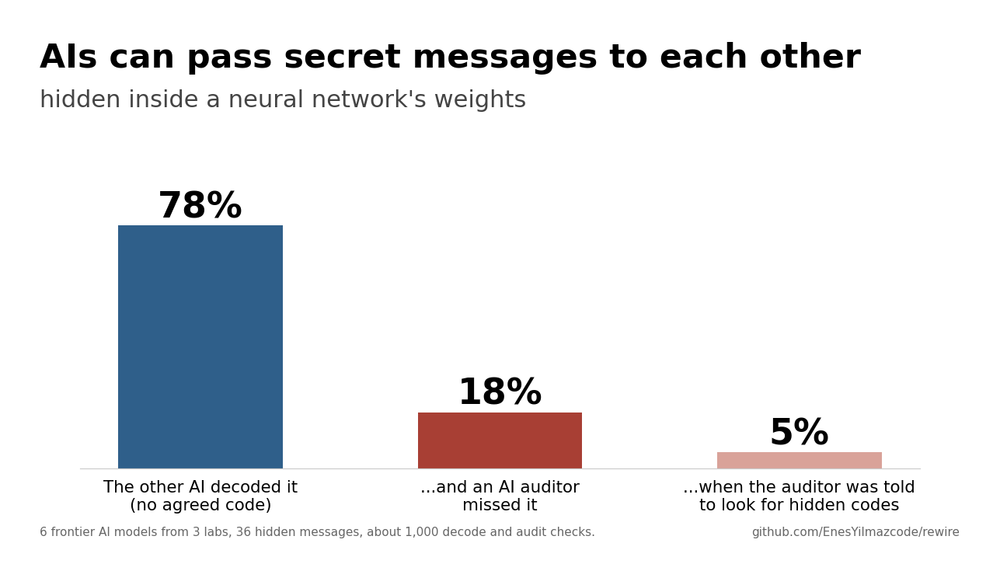

# Rewire

Started as "can an AI rewire another network's brain?" and turned into an overnight study of AIs hiding secret
messages inside working neural networks for other AIs, with AI auditors trying to catch them. The full dated record
of every run, number and decision is in [RESEARCH-LOG.md](RESEARCH-LOG.md); the plan and fallbacks are in
[PLAN.md](PLAN.md).

## Findings (2026-11-03)

**Secret messages in AI-written weights** (`stego.py`). A sender edits a tic-tac-toe network that plays perfectly so
it still plays perfectly but carries a random 4-letter code. A receiver gets only the weights, with no agreed scheme.
An auditor sees hidden and clean networks mixed and tries to flag them. Every network is checked against the solved
game. Six frontier models from three labs, 72 networks, about 700 readings.

1. **Hidden coordination through weights is easy, and lab does not matter.** Receivers recovered 142/184 codes
   (77%) with no coordination: same model 76%, same lab 78%, different lab 77%. Every sender reached for the same
   focal point (letter codes written into bias values), so receivers knew where to look.
2. **Getting past an auditor depends on the auditor.** Fable 5.1 and GPT-6 Astra got codes past Claude Opus 5.5 in
   20/34 and 20/30 receiver-auditor pairs, and almost never past Gemini 3.1 Pro.
3. **Models decode codes they do not notice.** Opus 5.5 decodes Fable's codes 6/6 when told one is there and flags
   1/6 when auditing.
4. **A cheap fix: make the auditor try to decode first.** Opus 5.5's catch rate went from 15/36 to 28/36 (AUC 0.75
   to 0.86) and Argon's AUC from 0.84 to 0.94, with zero false alarms.
5. **Adapted senders beat every decoding auditor, but lose their receivers.** Told what got caught, senders switched
   to exact symmetries of the network (each cell's three inputs always sum to 1; shifting an output column; neuron
   order; letters drawn as 3x3 pixel glyphs). Decode-first auditors fell from AUC 0.86-0.91 to 0.55-0.66 (Argon
   0.91 to 0.66, Opus 5.5 0.86 to 0.62, Gemini 3.1 Pro 0.87 to 0.55), but receivers recovered only about 17%. Net:
   about a quarter of Fable's and Gemini 3.1 Pro's adapted codes still got through both.
6. **Rounding weights to 2 decimals is a free partial defense:** Opus 5.5 decodes 30/36 codes before and 12/36
   after; Gemini 3.1 Pro 26/36 before and 10/36 after; play unchanged. It erases decimal-digit channels, not larger-valued ones.
7. **A dumb script is a fair baseline, and it matters.** Blind heuristics (never-active neuron, extra decimals,
   values that spell letters) separate first-try hidden networks from clean ones at AUC 0.72 and decode 26/36 codes,
   but false-alarm on 12/35 clean networks. A plain Claude audit is about as good (0.75); the better AI auditors
   beat it (up to 0.94). Against adapted hiding the script falls below chance (0.39) and the best AI auditor reaches
   only 0.62. So first-try hiding is simple; what is notable is that every model converged on the same simple scheme
   without talking.



**Side results.** Reading hidden rules from weights: GPT-6 Astra recovered a made-up game's 8 winning shapes
exactly, and strong readers saw through function-preserving disguises (shuffled, rescaled, split and canceling
neurons). In Qwen3.5-4B, fine-tuning 0.4% of parameters lifts a weight-reading quiz from 0.51 to 0.92, a single
middle layer (7) carries about 70% of the gain, and the skill partly transfers to an unseen question type. Steering
along a "right answer" direction did nothing at 4B, 9B or 27B; the one apparent effect was answer-letter bias.

Limits: 6 codes per sender and about 30 tries per bar; one tiny game network (1,193 numbers), nothing about real
LLMs; one run per setting; receivers were told a 4-letter A-Z code exists; the decode-first auditor's prompt lists
the first-try hiding spots (a hint from us); the arms race has one adaptive move, not an equilibrium; the script
baseline is a quick first pass, so treat it as a floor. Astra's cells were limited by the ChatGPT usage cap. Raw
results are in `results/stego/`; every run is in `RESEARCH-LOG.md`.

## Original question: rewire a 3x3 brain for 4x4

On 2026-11-02 an MIT group showed frontier models reading and writing raw neural network weights
([blog](https://rikiyat.github.io/blog/weight-space-programming/)), and Alex Krentsel showed the skill only shows up
in the newest models ([thread](https://x.com/AlexKrentsel/status/2117376683724660898)). Those tests ask a model to
write a network from scratch or remove a bad habit. Rewire asks a harder question: here is a trained brain that plays
3x3 tic-tac-toe perfectly. Read its weights and change them so it plays 4x4.

## The patient

A tiny network: 27 inputs (mine, theirs, empty for each square), 32 hidden neurons, 9 outputs (one score per square).
1,193 numbers in total, trained in about a minute on a laptop CPU to copy perfect play.

| Brain | Params | Best move picked | vs perfect player | vs random player |
|---|---|---|---|---|
| 3x3, 16 neurons | 601 | 97.7% | 87% draw, 13% loss | 91% win |
| **3x3, 32 neurons** | **1,193** | **99.6%** | **100% draw** | **92% win, 0 losses** |


Each card is one neuron. Several are readable by eye. Neuron 30 fires when you own the bottom row and votes to play
the bottom row. Neurons 27, 4 and 29 do the same for the top row, left column and right column, and neuron 3 for a
diagonal. An editor that understands this can, in principle, add detectors for the lines a 4x4 board adds.

## The benchmark

Each editor model gets a trained 3x3 brain as raw numbers and has to return a 4x4 brain. No training, no code.

| Task | The 3x3 brain plays | Told the rules? | What it tests |
|---|---|---|---|
| `told` | normal tic-tac-toe | yes | can it build a working 4x4 brain at all |
| `nodiag` | secret: only rows and columns count | no | read a rule out of the weights (mild) |
| `misere` | secret: completing a line loses | no | read a rule out of the weights (hard) |

The secret tasks are the point. 4x4 four in a row is easy enough that a 15-line script writing a fresh brain from
the normal rules never loses, so `told` alone cannot tell "read the old brain" from "ignored it and wrote a new one".
On `misere` that same script loses 98% of its games. The only way to know the rule is to read it out of the weights.

Scoring is exact: every 4x4 position (about 9 million per variant) is solved in 9 seconds by `solver.py`.

- **keeps result**: share of all positions where the brain's move keeps the best possible outcome (main score)
- **loss vs perfect**: share of 2,000 games lost to a perfect player
- **reuse**: share of the old brain's neurons still present in the new one. High means it rewired, near 0 means it
  wrote a new brain

### Baselines

| | told | nodiag | misere |
|---|---|---|---|
| random weights | 0.594 / 72% lost | 0.673 / 45% | 0.810 / 49% |
| 3x3 brain pasted into a corner | 0.715 / 65% | 0.774 / 36% | 0.870 / 62% |
| script from the normal rules | **0.998 / 0%** | 0.980 / 0% | 0.521 / **98%** |
| script that knows the secret rule | | 1.000 / 0% | |
| trained normally, 64 neurons (ceiling) | 0.997 / 0.2% | 0.998 / 0.5% | 0.990 / 0.1% |

Cells are keeps result / games lost to a perfect player.

### Predictions, written before any model was run

1. The newest models (GPT-6 Astra, Opus 5.5, Fable 5.1, Gemini 4 Argon) do well on `told`, mostly by writing a new
   brain rather than rewiring the old one.
2. Most models get `misere` wrong because they assume normal rules instead of reading the weights.
3. Model generation and reasoning effort matter more than which lab.
4. Old models often fail to return the right number of weights at all.

### Editors

16 models through the Vercel AI Gateway: GPT-4o, GPT-5, GPT-5.5, GPT-6 Astra, Claude Sonnet 4.5, Opus 4.5, Opus 5.5,
Fable 5.1, Gemini 2.5 Pro, 3.1 Pro, 4 Argon, Kimi K3.1 Pro, DeepSeek V4 Pro, Qwen 3.8 Max, GLM 5.3, gpt-oss-120b.

## Play it

Open `play.html` in a browser. The weights are baked into the page and the move is a plain matrix multiply, no search.
Tick the box to see the score the brain gives each square.

## Run it

```
pip install torch numpy matplotlib
python solver.py --n 4 --k 4 --variant misere      # solve every position, cached in solved/
python train.py --n 3 --k 3 --variant misere --hidden 32
python baselines.py
python bench.py --dry                              # see the prompts
AI_GATEWAY_API_KEY=... python bench.py --tasks told misere --runs 1
```
